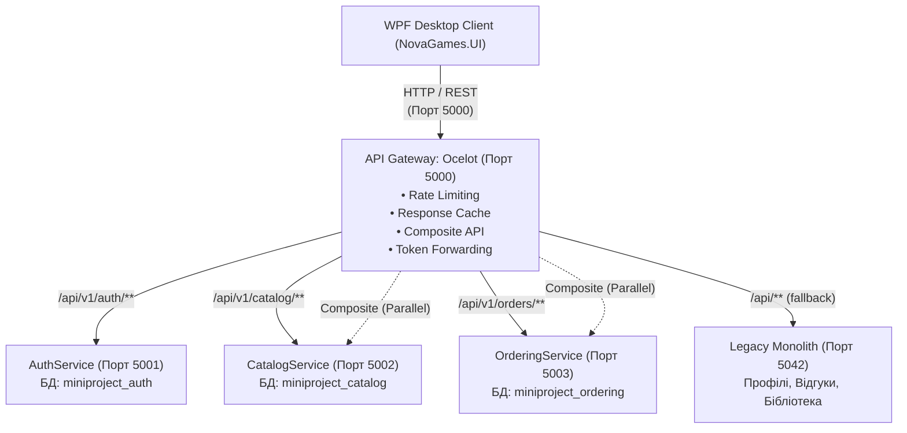

# Фінальний конспект захисту мініпроєкту NovaGames
> **Дисципліна:** Архітектура програмного забезпечення / Мікросервісна архітектура  
> **Студент:** Іван Сафрюк (група 543)  
> **Проєкт:** Цифрова дистрибуція ігор NovaGames — Міграція з моноліту на мікросервіси  

---

## Частина 1. Конспект презентації (8 слайдів)

### Слайд 1. Тема та стек проєкту
- **Тема:** Декомпозиція монолітного інтернет-магазину цифрової дистрибуції ігор NovaGames на мікросервісну архітектуру.
- **Мета:** Підвищення відмовостійкості, ізоляція критичних доменних областей (автентифікація, каталог, замовлення) та забезпечення незалежного масштабування.
- **Технологічний стек:**
  - **Бекенд:** .NET 10 (C#), ASP.NET Core Web API, Minimal APIs;
  - **API Gateway:** Ocelot + Custom Middleware (кешування, композитний API, Rate Limiting);
  - **Бази даних:** MySQL (окремі фізичні схеми: `miniproject_auth`, `miniproject_catalog`, `miniproject_ordering`);
  - **Клієнт:** WPF (.NET 10 Windows Desktop);
  - **Безпека:** JWT Bearer (HS256) + Refresh Tokens + RBAC (`Admin`, `User`);
  - **Тестування:** xUnit, `Microsoft.AspNetCore.Mvc.Testing` (WebApplicationFactory), Moq (20 тестів: 4 Client, 10 Ordering, 6 Gateway).

---

### Слайд 2. Вихідний моноліт та чому ми його розділили
- **Що було (Моноліт):**
  - Усі модулі (користувачі, каталог, кошик, замовлення, бібліотека, відгуки) працювали в єдиному процесі на порту 5042.
  - Єдина спільна база даних `novagames_monolith` з перехресними Foreign Keys між таблицями `Orders`, `Games`, `Users`.
- **Чому вирішили різати (Проблеми моноліту):**
  1. **Single Point of Failure (єдина точка відмови):** Збій або підвищене навантаження на модуль оформлення замовлень чи звітності блокував роботу всього магазину.
  2. **Неможливість масштабування окремих компонентів:** Каталог переглядають 95% користувачів, а купують лише 5%. У моноліті доводиться масштабувати все разом із важкою бізнес-логікою оплат.
  3. **Tight Coupling (жорстка зв'язаність):** Будь-яка правка структури БД ламала інші, не пов'язані з нею модулі.

---

### Слайд 3. Цільова мікросервісна архітектура
- **Ocelot API Gateway (порт 5000):** Єдина точка входу (Single Entry Point) для клієнтів. Приховує внутрішню мережу, маршрутизує запити, виконує Rate Limiting, віддає композитні дані.
- **AuthService (порт 5001):** Реєстрація, видача JWT Access/Refresh токенів, перевірка ролей. Власна БД `miniproject_auth`.
- **CatalogService (порт 5002):** Каталог ігор, серверна пагінація (`IQueryable`), фільтрація, керування залишками копій. БД `miniproject_catalog`.
- **OrderingService (порт 5003):** Оформлення покупок, генерація цифрових ключів, ідемпотентність, скасування замовлень. БД `miniproject_ordering`.
- **Залишковий Monolith (порт 5042):** Неперенесені другорядні модулі (профілі, бібліотека користувача, відгуки).
- **Клієнт (WPF UI):** Працює **строго** через порт 5000. Не знає жодного внутрішнього порту.



---

### Слайд 4. Стратегія міграції — Патерн Strangler Fig (Душитель)
- **Суть патерну:** Ми не переписували систему з нуля «в один день» (Big Bang Rewrite). Ми поступово «обплітали» моноліт новими мікросервісами, поки старий функціонал перенаправлявся шлюзом.
- **Етапи міграції:**
  1. **ЛР0:** Підготовка домену, виділення контрактів та первинне налаштування Ocelot як зворотного проксі.
  2. **ЛР1 (Auth + Catalog):** Створення бібліотеки `Shared`, винесення користувачів у `AuthService`, винесення каталогу в `CatalogService`. Автономна валідація JWT за публічним ключем без запитів до бази.
  3. **ЛР2 (Ordering):** Відокремлення замовлень в `OrderingService`. Розрив Foreign Keys (зв'язок за `UserId` та `GameId`). Забезпечення ідемпотентності через заголовок `Idempotency-Key`. Міграція історичних даних.
  4. **ЛР3 (Розширення шлюзу):** Складений ендпоінт (`GET /api/v1/store/game-details/{id}`), In-Memory кешування каталогу з відстеженням метрик Hits/Misses, Sliding Window Rate Limiting (5 req/min для логіну).
  5. **ЛР4 (Клієнт):** Реалізація `AuthHandler` у WPF-застосунку, автопідстановка токена, 1-shot refresh token, перенаправлення 100% трафіку клієнта на порт 5000.

---

### Слайд 5. Найважче архітектурне рішення
> **Проблема:** Як забезпечити узгодженість даних між Каталогом і Замовленнями при відсутності спільних транзакцій та зовнішніх ключів (Foreign Keys)?

- **У моноліті:** Покупка відбувалася в одній ACID-транзакції: `INSERT INTO Orders` + `UPDATE Games SET Stock = Stock - 1`. База гарантувала цілісність через FK.
- **У мікросервісах:** Дві різні фізичні БД на різних портах. Двофазний коміт (2PC) повільний і створює блокування.
- **Наше рішення:**
  1. **Розрив зв'язку:** `OrderingService` зберігає лише `GameId` та фіксує `UnitPrice` на момент покупки (історичний знімок ціни).
  2. **Захист від подвійного списання (Ідемпотентність):** Клієнт генерує `Idempotency-Key` (GUID). Якщо при поганому інтернет-з'єднанні клієнт повторить запит, `OrderingService` знайде існуюче замовлення в таблиці `Orders` і поверне `200 OK` замість створення дубліката.
  3. **Композитний API з частковою деградацією:** Шлюз паралельно запитує Catalog та Ordering. Якщо OrderingService тимчасово «лежить», шлюз повертає інформацію про гру з плашкою деградації, не блокуючи перегляд товару.

---

### Слайд 6. Що реально працює, а що є технічним компромісом
- **Що реально працює (100% готовність):**
  - Повний наскрізний ланцюжок: Авторизація (JWT) $\rightarrow$ Каталог із серверною пагінацією та кешем $\rightarrow$ Деталі гри (1 композитний запит) $\rightarrow$ Оформлення з `Idempotency-Key` $\rightarrow$ Історія покупок та скасування замовлень.
  - Rate Limiter ефективно блокує спроби підбору паролю (HTTP 429 з заголовком `Retry-After: 60`).
  - Усі 20 автоматичних тестів у рішенні повністю зелені.
- **Технічні компроміси (що варто покращити для Enterprise-рівня):**
  1. **Синхронний HTTP між шлюзом та сервісами:** Замість HTTP-запитів для високих навантажень краще використати брокер повідомлень (RabbitMQ / Apache Kafka) та підхід Event-Driven Architecture.
  2. **In-Memory Cache замість Redis:** Зараз кеш живе в оперативній пам'яті шлюзу (`IMemoryCache`). Якщо запустити 3 інстанси шлюзу, кеш розсинхронізується; для продакшну потрібен Redis.
  3. **Dual Writes:** При скасуванні замовлення повернення копії в каталог поки що робиться прямим запитом, тоді як у продакшні потрібна повноцінна сага (Saga Orchestration).

---

### Слайд 7. Що змінилося в логіці бекенду після переходу на мікросервіси
| Критерій | Було в Моноліті | Стало в Мікросервісах |
| :--- | :--- | :--- |
| **Автентифікація** | Сесії або прямий запит до таблиці `Users` у монолітній БД при кожному кліку. | Криптографічний JWT-токен. Сервіси валідують підпис локально за секретним ключем без звернення до БД. |
| **Зв'язок між даними** | Фізичні Foreign Keys (`FK_Orders_Users`, `FK_Orders_Games`). База забороняла биті посилання. | Логічний зв'язок за ID. `OrderingService` зберігає копію ціни гри (`PriceAtOrder`) на момент покупки. |
| **Транзакції** | Локальні ACID-транзакції (`DbContext.Database.BeginTransaction()`). | Eventual Consistency (кінцева узгодженість) та ідемпотентність операцій через `Idempotency-Key`. |
| **Мережева топологія** | Клієнт викликав один порт моноліту (`7232`/`5042`). | Ocelot Gateway (порт 5000) приховує 4 сервіси, агрегує запити, контролює ліміти (Rate Limiting). |
| **Обробка помилок** | Падіння бази клало весь сайт. Стек-трейси вилітали в UI. | Часткова деградація (Graceful Degradation) + стандартизований RFC 7807 `ProblemDetails`. |

---

### Слайд 8. Висновки
1. Проєкт успішно трансформовано з моноліту на модульну мікросервісну архітектуру за патерном Strangler Fig.
2. Реалізовано повну ізоляцію даних: кожен мікросервіс володіє власною базою даних і не має доступу до сусідніх.
3. Досягнуто високої швидкодії завдяки серверному кешуванню, пагінації та композитним ендпоінтам, що зменшують кількість запитів з боку клієнта.
4. Клієнтський WPF-застосунок повністю переведений на роботу через захищений API Gateway.

---

## Частина 2. Сценарій живого демо (Що саме показувати на захисті)

### Підготовка перед показом (за 2 хвилини до показу):
1. Переконайся, що служба **MySQL** запущена.
2. Відкрий PowerShell і запусти всі сервіси однією командою:
   ```powershell
   cd D:\Dev\source\repos\MiniProject
   .\start-services.ps1
   ```
   *(Відкриються вікна для Gateway, AuthService, CatalogService, OrderingService та Monolith).*
3. Запусти клієнт `NovaGames.UI` через Visual Studio (або `dotnet run --project src\Monolith\NovaGames.UI`).

---

### Покроковий маршрут демонстрації інтерфейсу:

#### Крок 1. Екран входу (Автентифікація через Gateway)
- **Що робити:** Введи пошту `student@novagames.com` та пароль `Student123!` (або адміна `admin@novagames.com` / `Admin123!`).
- **Що сказати викладачу:**  
  *«Вхід відбувається через єдину точку — API Gateway на порту 5000 (`POST /api/v1/auth/login`). Шлюз перенаправляє запит до AuthService (порт 5001), який генерує JWT Access Token та Refresh Token. Зверніть увагу: на цьому ендпоінті налаштовано Rate Limiting — не більше 5 запитів на хвилину, щоб захиститися від brute-force атак»*.

#### Крок 2. Каталог ігор (Кешування, Debounce, Пагінація)
- **Що робити:** Перейди на вкладку «Каталог» (Магазин). Введи в пошуковий рядок назву гри (наприклад, `Cyberpunk` або `Witcher`).
- **Що сказати викладачу:**  
  *«Клієнт використовує Debounce у 400 мілісекунд при введенні в пошук: запити не надсилаються на кожну літеру, що заощаджує ресурси шлюзу. Список ігор підвантажується з CatalogService через шлюз. На шлюзі працює In-Memory кешування: повторний запит сторінки береться з пам'яті за 1-2 мс, не навантажуючи базу даних каталогу»*.

#### Крок 3. Деталі гри (Композитний API Gateway)
- **Що робити:** Клікни на будь-яку гру (наприклад, *Cyberpunk 2077*).
- **Що сказати викладачу:**  
  *«Тут застосовано ключовий патерн Лабораторної №3 — Composite API (агрегація запитів). Клієнт робить **рівно один запит** на `GET /api/v1/store/game-details/{id}`. API Gateway самостійно паралельно опитує CatalogService (інформація про гру, ціна, системні вимоги) та OrderingService (чи куплена ця гра користувачем), агрегує відповідь і віддає готовий DTO»*.

#### Крок 4. Оформлення замовлення (Ідемпотентність `Idempotency-Key`)
- **Що робити:** Додай гру до кошика, відкрий кошик і натисни «Оформити замовлення».
- **Що сказати викладачу:**  
  *«При створенні замовлення клієнт генерує унікальний заголовок `Idempotency-Key` (GUID) і передає його в запиті `POST /api/v1/orders`. Якщо з'єднання обірветься і клієнт повторить запит, OrderingService знайде цей ключ і не спише кошти повторно, повернувши вже існуючий номер замовлення»*.

#### Крок 5. Екран «Історія покупок» (4 стани екрана UI)
- **Що робити:** Відкрий профіль користувача $\rightarrow$ вкладка «Історія покупок». Покажи список створених замовлень. Натисни кнопку «Скасувати» на одному із замовлень.
- **Що сказати викладачу:**  
  *«Цей екран реалізовано у ЛР4 згідно з вимогами до 4 станів інтерфейсу: Loading (індикатор завантаження), Success (картки замовлень), Empty (якщо замовлень немає — перехід у каталог) та Error (при відсутності зв'язку зі шлюзом — дружнє повідомлення та кнопка "Повторити спробу"). Тут же реалізовано можливість скасування замовлення через шлюз»*.

#### Крок 6. Фінал (Демонстрація Ocelot Gateway у браузері)
- **Що робити:** Відкрий у браузері вкладку `http://localhost:5000/`.
- **Що показати:** Покажи інтерактивну сторінку шлюзу з посиланнями на `/api/v1/gateway/cache-metrics`, `/health` та Scalar API Reference (`http://localhost:5000/scalar/v1`).
- **Що сказати:**  
  *«Ось дашборд нашого API Gateway: видно метрики кешу (Hits/Misses), маршрутизацію до всіх мікросервісів та агреговані Health Checks»*.

---

## Частина 3. Що змінилося в логіці бекенду (Простими словами для викладача)

Якщо викладач запитає: *"А що концептуально змінилося в коді бекенду після переходу?"*, ось 3 головні тези, які покажуть найвищий рівень розуміння:

1. **Автономна валідація JWT (Zero Trust до клієнта, Zero Requests до Auth):**
   *У моноліті при кожному кліку перевірялася сесія в базі. Тепер `AuthService` видає підписаний JWT. Коли клієнт іде в `CatalogService` або `OrderingService`, ці сервіси перевіряють криптографічний підпис токена локально за допомогою секретного ключа (з `Shared`). Вони не роблять жодного мережевого запиту до `AuthService`, що дає колосальну швидкість і автономність.*
2. **Розрив Foreign Keys та Snapshotting (знімок даних):**
   *У моноліті в таблиці `OrderItems` був зовнішній ключ `FK` на таблицю `Games`. Якщо гра видалялася або змінювалася ціна — це зачіпало старі чеки. У мікросервісах бази фізично розділені: `OrderingService` зберігає `GameId` як звичайне число і записує `UnitPrice` на момент покупки. Навіть якщо в каталозі гра подорожчає чи видалиться, історія замовлень залишається незмінною та цілісною.*
3. **Ідемпотентність замість ACID-транзакцій:**
   *У моноліті якщо користувач двічі клікнув «Оплатити», рятувала транзакція на рівні рядка в базі. У мікросервісах клієнт передає заголовок `Idempotency-Key: <guid>`. `OrderingService` перевіряє: якщо замовлення з таким ключем уже створено в базі, він не проводить операцію вдруге, а просто повертає статус `200 OK` зі створеним замовленням.*

---

## Частина 4. Захист на чужому ноуті або Linux: Важливі нюанси

> [!WARNING]
> **Критичний момент щодо WPF та Linux:**  
> Клієнтський застосунок `NovaGames.UI` написаний на **WPF (Windows Presentation Foundation)**.  
> WPF є частиною Windows Desktop Runtime і **не підтримується нативно на Linux**!  
> Бекенд (.NET Web API) працює на будь-якій ОС (Linux, macOS, Windows) через Docker або `dotnet run`, але десктопний UI запуститься **лише на Windows**.

### Як вирішити це для захисту:

1. **Варіант 1 (Найкращий і найнадійніший):**
   - Позичити у когось ноутбук саме з **Windows** (у багатьох одногрупників Windows).
   - На ньому потрібно лише встановити .NET 10 SDK та запустити MySQL (або через наш `docker-compose.yml`).
2. **Варіант 2 (Захист через віддалений робочий стіл — «План Б»):**
   - Залиши свій домашній ПК увімкненим.
   - Встанови на ПК **AnyDesk** або **RustDesk** (він безкоштовний, працює швидко і без обмежень).
   - На чужому ноуті (навіть на Ubuntu / Linux чи MacBook) ти відкриваєш AnyDesk, підключаєшся до свого комп'ютера за 5 секунд і демонструєш викладачу повністю запущений наживо застосунок у рідному середовищі! Це виглядає дуже професійно і гарантує, що жоден шрифт чи драйвер не злетить.
3. **Варіант 3 (Якщо на захисті суто Linux і немає інтернету для AnyDesk):**
   - Бекенд запускається через `docker-compose up -d`.
   - Інтерфейс і взаємодія демонструються через браузер за адресою `http://localhost:5000/scalar/v1` (інтерактивна консоль запитів Scalar — логін, отримання токена, створення замовлення) та дашборд `http://localhost:5000/`.
